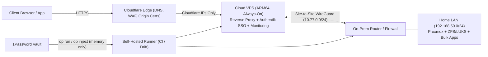

# Hybrid Homelab IaC Reference

Sanitized reference architecture and repository layout for operating a **cloud edge + on-prem homelab** estate declaratively with **OpenTofu**, **Ansible**, **Docker Compose / Portainer GitOps**, **WireGuard**, **Authentik SSO**, and **1Password** secret injection.

All identifiers, addresses, domains (`example.com`), and `op://` paths in this repository are synthetic placeholders.

## Topology



## Key Design Patterns

1. **Zero Plaintext Secrets in Git or on Disk**
   - Templates commit only `op://` URIs (`secrets/*.env.tpl`).
   - CI preloads vault items once into process memory before running OpenTofu, Ansible, or Portainer API calls.
2. **Desired-State Inventory & Nightly Drift Detection**
   - `inventory/{hosts,services,backups}.yml` is the single source of truth for endpoints, deployment ownership, backup tiers, and cold failover targets.
   - CI runs `tofu plan` across Cloudflare, Cloud VPS, and RouterOS stacks on every push and nightly schedule, opening or clearing a drift issue automatically.
3. **Edge-to-Home Isolation**
   - Public proxied vhosts reject direct-to-origin traffic outside Cloudflare CIDR ranges while allowing explicit DNS-only vhosts where large body uploads or raw API clients require direct origin access.
   - The cloud node acts as the single public ingress, identity provider (`auth.example.com`), and observability hub, reaching private homelab backends exclusively over WireGuard.
4. **Fail-Closed Storage & Demand-Based Wake-on-LAN**
   - On-prem encrypted ZFS storage waits for explicit LUKS keyfile validation and mount-point guards (`AssertPathIsMountPoint`) before SMB or containers start.
   - An observe-first `waker` service tracks backend reachability and exposes Prometheus metrics (`homelab_asleep`), dispatches RouterOS REST Wake-on-LAN calls on demand, and returns `503 Retry-After` or a holding page while waking.

## Quickstart

```bash
# 1. Validate inventory & rendered topology docs
python3 scripts/validate_inventory.py

# 2. Check OpenTofu formatting and configuration
tofu -chdir=tofu/cloudflare fmt -check
tofu -chdir=tofu/oci fmt -check
tofu -chdir=tofu/routeros fmt -check

# 3. Syntax-check Ansible playbooks
ansible-playbook -i ansible/inventory.yml ansible/site.yml --syntax-check
```
